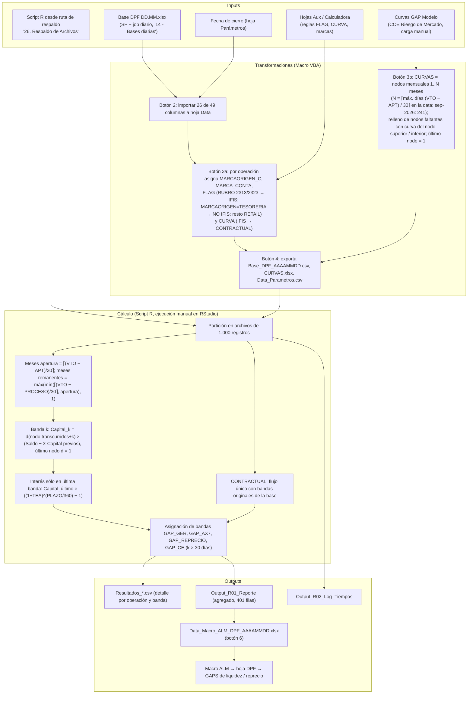
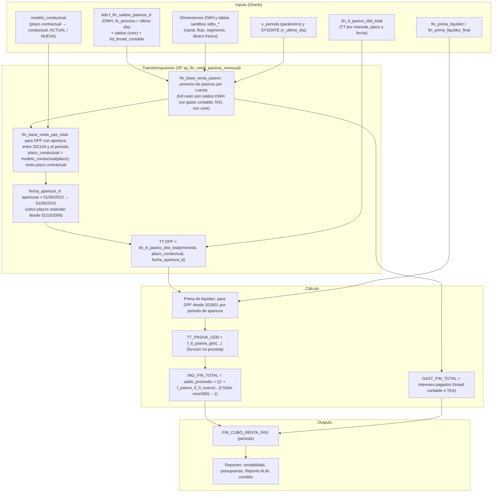
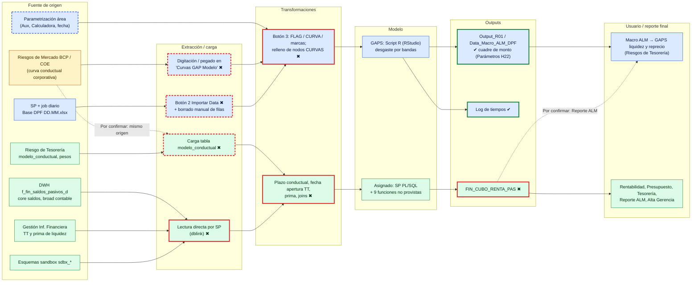

# Validación de Implementación – Modelo Conductual MCR Depósitos a Plazo (DPF)
## Fase 1: Inventario y entendimiento (módulos GAPS y Asignado)

| Campo | Detalle |
|---|---|
| Documento | Entregable de Fase 1 – borrador para validación del usuario |
| Fecha | 16/11/2026 |
| Repositorio revisado | `github.com/DanteBarreto/Validaci-n-Implementaci-n---MCR-Dep-sitos-a-Plazo`, commit `431d328` (16/11/2026) |
| Estándar | `Estandares_VIRF_conductuales.md` (adjunto), Sección 1 |
| Estado | **Sin conclusiones de cumplimiento.** Las observaciones de este documento son descriptivas y se califican en la Fase 2. |
| Anexo | `Fase1_Inventarios_y_Mapa_Inputs.xlsx` (checklist, inventarios, mapa de inputs, inconsistencias, pasos de la grabación) y `diagramas/*.mmd` |

---

## 0. Aspectos que requieren atención inmediata

1. **Confidencialidad del repositorio (INC-23).** El repositorio de GitHub es **público**: se clonó sin credenciales mediante acceso anónimo. Contiene datos a nivel de operación (95.874 DPF con código de cliente y número de desembolso en `Base_DPF_20260930.csv`, y número de cuenta y número de documento de identidad en las muestras de Asignado). Esto contradice la indicación de tratar la información como confidencial. Se recomienda evaluar con el dueño del repositorio su paso a privado. El validador no ha realizado ninguna acción sobre el repositorio.
2. **Grabación incompleta (INC-15).** El archivo `Flujo de Generación DPF-GAPS.mp4` está truncado: de 1.725 s declarados sólo son decodificables ≈65 s (1.043 de 27.601 cuadros; el tamaño esperado a la tasa de bits del archivo es ≈100 MB y el archivo tiene 3,9 MB). La reunión completa se cubre con la **transcripción de Teams** incluida en el repositorio (`Flujo de Generación DPF - GAPS.docx`), por lo que **no fue necesario instalar herramientas externas de transcripción**. Los cuadros del primer minuto se extrajeron localmente con `ffmpeg`, ya instalado en el entorno, sin enviar datos fuera. La verificación visual del proceso posterior al minuto 1:05 no es posible con el archivo actual.
3. **Alcance del checklist (INC-22).** El `.xlsx` del estándar que está en el repositorio contiene una tercera hoja (*Modelos TIR I, II y III*) con 29 actividades marcadas para *Validación de Implementación – Primera vez*. De ellas, 26 no figuran en el `.md` adjunto (sección 1.2). Se requiere definir si forman parte del alcance de la Fase 2.

---

## 1. Inventario de criterios del estándar

### 1.1 Checklist del `.md` (40 actividades)

Resumen: Documentación 14 (DOC-01 a DOC-14), Calidad de Datos 14 (CDD-01 a CDD-14), Implementación 9 (IMP-01 a IMP-09) y Gobierno 3 (GOB-01 a GOB-03). Hay **19 actividades `KILLER`**, de las cuales **7 son además `SOX`** (DOC-09 a DOC-12 y CDD-01 a CDD-03). GOB-02 y GOB-03 son prerrequisitos y, según §0 del estándar, se verifican primero.

Reglas del estándar que aplican a la evaluación (§0):
- Resultado por actividad: `CUMPLE`, `NO CUMPLE`, `NO APLICA` (justificado) o `SIN EVIDENCIA`, con evidencia y justificación breve.
- Si una actividad `KILLER` resulta `NO CUMPLE` o `SIN EVIDENCIA`, la validación **no puede concluir favorablemente**.
- `SOX` exige evidencia trazable (capturas, logs, actas); la declaración del equipo no basta.
- Los umbrales cuantitativos se aplican literalmente: CDD-04 (0 duplicados), CDD-06 y CDD-13 (≥ 99 % sin desfase, ≥ 95 % con desfase, cobertura de 3 meses o 3 días), CDD-14 (ARM en ≥ 2 periodos) y GOB-02 (nota ≥ Aceptable).
- **Escala de severidad:** el estándar no define una. Para la Fase 2 se propone Alta / Media / Baja, con Alta para cualquier actividad `KILLER` que no cumpla.
- **Equivalencia de escalas:** la instrucción del usuario (Cumple / Cumple parcialmente / No cumple / No evaluable / No aplica) se reportará junto a la escala del estándar. Para el tratamiento de actividades `KILLER`, *Cumple parcialmente* se tratará como `NO CUMPLE` y *No evaluable* como `SIN EVIDENCIA`.
- La columna *Evidencia esperada* es interpretación del validador, porque el estándar sólo la define de forma explícita para los controles `SOX`.

| ID | Etiquetas | Ámbito / control específico | Sección | Qué exige | Criterio de aceptación | Evidencia esperada |
|---|---|---|---|---|---|---|
| DOC-01 | — | Documentación – Revisión del Manual Metodológico | §1 l.26-27 | Verificar que el manual identifique el objetivo del FTP asignado, el nombre y código de los modelos afectados (Activos-Prepago y Pasivos-Depósitos) y la versión productiva evaluada. | No definido | Manual metodológico con objetivo del FTP asignado, nombre y código de modelos y versión productiva. |
| DOC-02 | — | Documentación – Revisión del Manual Metodológico | §1 l.29-30 | Evidenciar la curva conductual entregada por Riesgos de Mercado BCP (modelador corporativo) y los supuestos metodológicos usados para calcular el Asignado. | No definido | Correo/acta de remisión de la curva por Riesgos de Mercado BCP; documento de supuestos metodológicos del Asignado. |
| DOC-03 | KILLER | Documentación – Manual de Implementación / RUS / Bitácora de cambios | §1 l.34-35 | Existencia de control de cambios (fecha, versión, responsable, aprobado por, descripción del cambio) llenado y revisado. | No definido | Bitácora de control de cambios con los 5 campos, completada y con evidencia de revisión. |
| DOC-04 | KILLER | Documentación – Manual de Implementación / RUS / Bitácora de cambios | §1 l.37-38 | Existencia del/los ID del/los modelo(s) en base al inventario de control de riesgo de modelo. | No definido | ID del modelo según inventario de riesgo de modelo, consignado en la documentación. |
| DOC-05 | KILLER | Documentación – Manual de Implementación / RUS / Bitácora de cambios | §1 l.40-41 | Definición de generación de universos junto a los filtros aplicados y variables a extraer. | No definido | Definición documentada del universo, filtros y variables extraídas. |
| DOC-06 | KILLER | Documentación – Manual de Implementación / RUS / Bitácora de cambios | §1 l.43-44 | Lógica de imputaciones, transformaciones/cálculos y cotas utilizadas para el cálculo del output. | No definido | Descripción documentada de imputaciones, transformaciones, cálculos y cotas. |
| DOC-07 | KILLER | Documentación – Manual de Implementación / RUS / Bitácora de cambios | §1 l.46-47 | La documentación debe detallar de manera completa todas las rutas y repositorios de almacenamiento, gestión y despliegue de los scripts. | No definido | Listado completo de rutas/repositorios en la documentación. |
| DOC-08 | KILLER | Documentación – Manual de Implementación / RUS / Bitácora de cambios | §1 l.49-50 | Evidencia visual de la arquitectura de directorios usada como repositorio para almacenamiento, organización y versionamiento de scripts. | No definido | Capturas de la estructura de directorios del repositorio de scripts. |
| DOC-09 | KILLER, SOX | Documentación – Manual de Implementación / RUS / Bitácora de cambios | §1 l.52-53 | Evidencia visual de usuarios, grupos y roles con privilegios de acceso a la arquitectura de directorios (repositorio de scripts). | No definido; SOX: evidencia trazable (capturas, logs, actas) | Capturas de permisos (ACL) del directorio de scripts. |
| DOC-10 | KILLER, SOX | Documentación – Manual de Implementación / RUS / Bitácora de cambios | §1 l.55-56 | Evidencia visual de usuarios, grupos y roles con privilegios de acceso al schema de las tablas input. | No definido; SOX | Capturas de grants/roles del schema de inputs. |
| DOC-11 | KILLER, SOX | Documentación – Manual de Implementación / RUS / Bitácora de cambios | §1 l.58-59 | Evidencia visual de la arquitectura de directorios usada como repositorio de respaldo para custodia de scripts. | No definido; SOX | Capturas de la ruta de respaldo de scripts. |
| DOC-12 | KILLER, SOX | Documentación – Manual de Implementación / RUS / Bitácora de cambios | §1 l.61-62 | Evidencia visual de que el schema de las tablas input cuenta con mecanismos de respaldo vigentes. | No definido; SOX | Capturas/políticas de backup del schema de inputs. |
| DOC-13 | — | Documentación – Revisión de Código Documentado (Scripts) | §1 l.66-67 | Control de cambios en la cabecera del programa, sólo si no existe bitácora ni herramienta de gestión de versiones. | Condicional | Cabecera con control de cambios en el script (si aplica la condición). |
| DOC-14 | — | Documentación – Revisión de Código Documentado (Scripts) | §1 l.69-70 | Comentarios funcionales sobre fragmentos de código (en caso no exista documentación). | Condicional | Comentarios funcionales en el código. |
| CDD-01 | KILLER, SOX | Calidad de Datos – Monitoreo de calidad de datos | §1 l.78-80 | Existencia y correcta ejecución del monitoreo de calidad de datos mínimos (duplicados, missings por variable), contraste mes actual vs anterior; semaforización si hay histórico; solución táctica con plazo de remediación si no está en el dashboard oficial. | No cuantificado; SOX | Reporte/notebook de calidad de datos ejecutado (mes actual vs anterior), semáforo, plan de remediación. |
| CDD-02 | KILLER, SOX | Calidad de Datos – Monitoreo de calidad de datos | §1 l.82-83 | Comunicación oportuna y periódica de resultados del monitoreo de calidad a stakeholders. | No definido; SOX | Correos/actas de comunicación periódica. |
| CDD-03 | KILLER, SOX | Calidad de Datos – Monitoreo de calidad de datos | §1 l.85-86 | Documento formal que consolide los resultados finales del seguimiento del modelo. | No definido; SOX | Informe formal de seguimiento. |
| CDD-04 | — | Calidad de Datos – Unicidad: duplicados | §1 l.92-94 | Validar que no existen registros duplicados según las llaves del modelo (cliente, producto, etc.). | 0 registros duplicados según llaves del modelo | Prueba de unicidad por llave sobre la tabla del modelo. |
| CDD-05 | — | Calidad de Datos – Unicidad: duplicados | §1 l.96-97 | No duplicados en la tabla desagregada a nivel de moneda, tasa, vencimiento, desembolso, cancelación y monto de desembolso. | No definido (implícito 0) | Prueba de unicidad sobre la combinación de campos. |
| CDD-06 | — | Calidad de Datos – Precisión y consistencia de variables insumo | §1 l.101-105 | Variables reconstruidas/replicadas vs tabla final, columna por columna. | Coincidencia ≥99% sin desfase; ≥95% con desfase; cobertura últimos 3 meses (mensual) / 3 días (diario) | Réplica columna a columna para 3 meses. |
| CDD-07 | — | Calidad de Datos – Precisión y consistencia de variables insumo | §1 l.107-108 | Revisar saldos negativos (saldo, interés, seguro) y su justificación. | No definido | Prueba de signo y justificación documentada. |
| CDD-08 | — | Calidad de Datos – Precisión y consistencia de variables insumo | §1 l.110-111 | No existan huecos de información entre periodos reportados. | No definido | Serie de periodos continua. |
| CDD-09 | — | Calidad de Datos – Precisión y consistencia de variables insumo | §1 l.113-114 | No missings cuando la tabla contiene información agregada. | No definido (implícito 0) | Conteo de nulos en tabla agregada. |
| CDD-10 | — | Calidad de Datos – Precisión y consistencia de variables insumo | §1 l.116-117 | No missings en codproducto, tipbanca, codsubsegmento, codmoneda, fecha de apertura y monto saldo (tabla desagregada). | No definido (implícito 0) | Conteo de nulos por variable listada. |
| CDD-11 | — | Calidad de Datos – Precisión y consistencia de variables insumo | §1 l.119-120 | Fecha de apertura no posterior a fecha de proceso. | No definido | Prueba de consistencia temporal. |
| CDD-12 | — | Calidad de Datos – Precisión y consistencia de variables insumo | §1 l.122-123 | Fecha de apertura no posterior a fecha de vencimiento. | No definido | Prueba de consistencia temporal. |
| CDD-13 | — | Calidad de Datos – Completitud: tamaño de universo | §1 l.127-131 | Universo reconstruido/replicado vs tabla final. | Coincidencia ≥99% sin desfase; ≥95% con desfase; cobertura 3 meses / 3 días | Conciliación de conteos para 3 periodos. |
| CDD-14 | — | Calidad de Datos – Volatilidad: motor ARM | §1 l.135-137 | Ejecutar el motor de calidad (ARM) sobre la tabla implementada en ≥2 periodos consecutivos. | Motor ARM ejecutado en ≥2 periodos consecutivos | Salida del motor ARM para 2 periodos. |
| IMP-01 | KILLER | Implementación – Revisión de las pruebas de inicio | §1 l.145-146 | Pruebas del equipo modelador que sustenten los impactos en las métricas de uso del Asignado. | No definido | Documento/archivo de pruebas e impactos. |
| IMP-02 | KILLER | Implementación – Revisión de las pruebas de inicio | §1 l.148-149 | Hallazgos de pruebas de inicio comunicados al negocio y plan de acción coordinado. | No definido | Correos/actas y plan de acción. |
| IMP-03 | KILLER | Implementación – Revisión de las pruebas de inicio | §1 l.151-152 | Resultados de pruebas de inicio comunicados oportunamente al negocio. | No definido | Correos/actas. |
| IMP-04 | KILLER | Implementación – Revisión de las pruebas de inicio | §1 l.154-155 | Conformidades del PO y del negocio. | No definido | Correo/acta de conformidad. |
| IMP-05 | — | Implementación – Uso de tablas no productivas o no validadas | §1 l.161-162 | No consumir tablas NO PRODUCTIVAS (Norma sandbox 4110.781.01.05) ni productivas no validadas; campos usados controlados en análisis de calidad y plan de regularización. | No definido | Inventario de tablas consumidas con su ambiente; análisis de calidad; plan de regularización. |
| IMP-06 | — | Implementación – Accesos limitados a pocas personas con perfil adecuado | §1 l.168-169 | Arquitectura de directorios del repositorio de scripts con definición clara de usuarios, grupos y roles. | No definido | Matriz de accesos del directorio. |
| IMP-07 | — | Implementación – Accesos limitados a pocas personas con perfil adecuado | §1 l.171-172 | Schemas de tablas con definición clara de usuarios, grupos y roles. | No definido | Matriz de grants del schema. |
| IMP-08 | KILLER | Implementación – Revisión de la política de backup | §1 l.178-179 | Arquitectura de directorios definida y habilitada como repositorio de respaldo de scripts. | No definido | Evidencia de ruta de respaldo habilitada. |
| IMP-09 | KILLER | Implementación – Revisión de la política de backup | §1 l.181-182 | Respaldos vigentes para el schema de tablas input. | No definido | Evidencia de backup vigente del schema. |
| GOB-01 | — | Gobierno – Funciones y responsabilidades | §1 l.190-191 | Quien brinda conformidad (modelador, PO, usuario final) es distinto al implementador. | No definido | Matriz de roles y evidencia de conformidad firmada por persona distinta. |
| GOB-02 | Prerrequisito | Gobierno – Alineamiento al gobierno de modelos | §1 l.197-199 y §0 l.15 | Existencia de validación metodológica con nota ≥ Aceptable antes de validar la implementación. | Nota de validación metodológica ≥ Aceptable | Informe de validación metodológica con nota. |
| GOB-03 | Prerrequisito | Gobierno – Alineamiento al gobierno de modelos | §1 l.201-202 y §0 l.15 | Verificar que el modelo no esté en uso antes o durante la validación de implementación. | No definido | Evidencia del estado de uso (inventario, correos). |

### 1.2 Actividades complementarias del `.xlsx` (pendiente de decisión de alcance)

Las actividades de las filas 94, 102 y 103 del `.xlsx` coinciden literalmente con GOB-01, GOB-02 y GOB-03 y no se repiten aquí. Los IDs `SUP-xx` son provisionales y los asignó el validador.

| ID provisional | Ámbito | Control específico | Fila .xlsx | Actividad | Relación con el .md |
|---|---|---|---|---|---|
| SUP-01 | Documentación | Revisión del Manual de Implementación/operativo | xlsx fila 15 | Existencia de control de cambios (fecha, responsable, "aprobado por") completado y revisado, así como el código de modelo(s). | Similar a DOC-03 (agrega 'código de modelo') |
| SUP-02 | Documentación | Revisión del Manual de Implementación/operativo | xlsx fila 16 | Descripción de los universos construidos, las muestras y/o simplificaciones realizadas, en caso aplique. | — |
| SUP-03 | Documentación | Revisión del Manual de Implementación/operativo | xlsx fila 17 | Definición funcional de las variables, transformaciones y cálculos utilizados. | — |
| SUP-04 | Documentación | Revisión del Manual de Implementación/operativo | xlsx fila 18 | Detalle del flujo de construcción del modelo (desde el abastecimiento de inputs hasta los usuarios finales) | — |
| SUP-05 | Documentación | Revisión del Manual de Implementación/operativo | xlsx fila 19 | Descripción de roles responsables del proceso de implementación (Modelador, Data Provider, Implementador, Usuarios). | — |
| SUP-06 | Documentación | Revisión del Manual de Implementación/operativo | xlsx fila 20 | Descripción del proceso de implementación (funciones, transformación, etc.). | — |
| SUP-07 | Documentación | Revisión del Manual de Implementación/operativo | xlsx fila 21 | Descripción de las fuentes/proveedores de información y la periodicidad de actualización. | — |
| SUP-08 | Documentación | Revisión del Manual de Implementación/operativo | xlsx fila 22 | Fecha de ejecución del modelo y periodicidad, en caso aplique. | — |
| SUP-09 | Documentación | Revisión del Manual de Implementación/operativo | xlsx fila 23 | Contingencias en caso el proceso falle. (Plan de Continuidad de negocio) | — |
| SUP-10 | Documentación | Revisión del Manual de Implementación/operativo | xlsx fila 24 | Detalle del flujo de conexión de softwares (R, Matlab, Pyhon, Excel, etc.) y aplicaciones tecnológicas (QRM, Herramienta Estratégica, F682 Adm. Riesgo de Mercado, Calypso, etc.) con sus respectivos administradores. | — |
| SUP-11 | Documentación | Revisión del Manual de Implementación/operativo | xlsx fila 25 | Verificar la justificación para el tratamiento de la información. (Ejem. por producto, plazo y moneda). | — |
| SUP-12 | Documentación | Revisión del Manual de Implementación/operativo | xlsx fila 26 | Descripción funcional de los principales fragmentos del código implementado. | — |
| SUP-13 | Documentación | Revisión del Manual de Implementación/operativo | xlsx fila 27 | Descripción y trazabilidad de las fuentes de datos. | — |
| SUP-14 | Documentación | Revisión del Manual de Implementación/operativo | xlsx fila 28 | Coherencia entre los nombres de las variables del manual versus los nombres de las variables en las bases/software, etc., en caso aplique. | — |
| SUP-15 | Documentación | Revisión del Manual de Implementación/operativo | xlsx fila 29 | Se especifican las librerías usadas en la implementación del modelo, señalando su versión. | — |
| SUP-16 | Documentación | Revisión del Manual de Implementación/operativo | xlsx fila 30 | La documentación contiene los puntos solicitados en los ámbitos Calidad de Datos e Implementación. | — |
| SUP-17 | Calidad de Datos | Aplicación de controles de calidad de datos de segunda línea. | xlsx fila 43 | Verificar la actualización de los inputs. | — |
| SUP-18 | Implementación | Reprogramación del código en ambiente productivo | xlsx fila 71 | Verificar existencia de correos y/o archivos donde se evidencie las pruebas de la implementación. | — |
| SUP-19 | Implementación | Reprogramación del código en ambiente productivo | xlsx fila 72 | Verificar que las pruebas deberan realizarse lo más cercano a la fecha de implementación. | — |
| SUP-20 | Implementación | Reprogramación del código en ambiente productivo | xlsx fila 73 | Revisar la métrica de aceptación de las pruebas realizadas. | — |
| SUP-21 | Implementación | Implementación directa | xlsx fila 75 | Correo del visto bueno del equipo de Finanzas y del equipo de Seguimiento y Análisis de Riesgo de ALM y Liquidez. | — |
| SUP-22 | Implementación | Validación de implementación del modelo (implementación directa) | xlsx fila 76 | Revisar la codificación en el software empleado para la implementación, en caso aplique | — |
| SUP-23 | Implementación | Validación de implementación del modelo (implementación directa) | xlsx fila 83 | Verificar que los resultados de los casos enviados al equipo implementador desarrollado en el motor o herramienta coincidan con los resultados del modelo reconstruido/replicado (diferencia de menos 1%). | Relacionada con CDD-06/CDD-13 (umbral 1 %) |
| SUP-24 | Implementación | Validación de implementación del modelo (implementación directa) | xlsx fila 84 | Revisar la conexión entre la asignación de tasas de transferencia y los supuestos conductuales. | — |
| SUP-25 | Implementación | Validación de implementación del modelo (implementación directa) | xlsx fila 85 | Revisar la conexión y aplicación de los supuestos conductuales en el GAP de reprecio, GAP de liquidez. | — |
| SUP-26 | Implementación | Verificar que los accesos a los activos de información esten limitados sólo a una cantidad pequeña de personas y con un perfil adecuado. | xlsx fila 86 | Verificar que los accesos de base de datos, a las carpetas compartidas para la implementación o en el ambiente de producción del modelo y aplicación productiva/código estén limitados solo a una cantidad pequeña de personas y con un perfil adecuado, verificando la correcta aplicación de política de contraseñas o enmascaramiento de contraseñas. | Relacionada con IMP-06/IMP-07 |

---

## 2. Inventario del repositorio

Todos los archivos se pudieron abrir. Hay dos excepciones parciales: el MP4 está truncado, y los objetos EMF/OLE embebidos en los manuales (imagen del script en el manual GAPS y Anexos 1-3 del manual Asignado) no son legibles como texto. El código VBA de la macro se extrajo localmente sin ejecutarla. Las fechas corresponden a metadatos internos de los archivos, ya que el historial de Git sólo registra la carga del 16/11/2026.

| Ruta | Tipo | Formato | Fecha / versión | ¿Abre? | Observaciones |
|---|---|---|---|---|---|
| README.md | Documentación | Markdown | Commit 16/11/2026 | Sí | Descripción de una línea del repositorio. |
| Estándares_VIRF_conductuales.xlsx | Documentación (estándar) | Excel | Creado 13/05/2020; modif. 16/11/2026 | Sí | Contiene 3 hojas: Checklist, Entregables y 'Modelos TIR I, II y III' (111 actividades). El .md adjunto sólo convierte las dos primeras. |
| Modelo DPF - GAPS/1. Manual/Manual de Herramienta de Modelo DPF - Gaps - v2.docx | Documentación (manual operativo) | Word | v02 – Febrero 2026 (control de cambios); creado 25/12/2024; modif. 10/02/2026 | Sí | 10 pasos operativos, supuestos y control de cambios (v01 sep-2025, v02 feb-2026). Incluye imagen EMF del script (no legible como texto). |
| Modelo DPF - GAPS/2. Script/01. Simulación Modelo DPF.R | Script (motor de cálculo) | R | Etiqueta interna 'Setiembre_2025. Versión 1.0' (l.241); en ruta de respaldo: 31/08/2025 (imagen manual Paso 3) | Sí | Distribución de flujos por curva de desgaste; 489 líneas. Librerías: TTR, RODBC, readxl, sqldf, stringr, dplyr, rstudioapi (sin versión). |
| Modelo DPF - GAPS/2. Script/.Rhistory | Log / historial de sesión R | Texto R | Sin fecha | Sí | Historial de una ejecución; contenido idéntico al script salvo codificación de comentarios. |
| Modelo DPF - GAPS/2. Script/Macro Modelo Conductual DPF en Gaps 30.09.xlsm | Script (orquestador) + input + output | Excel con VBA | Creado 11/08/2025; modif. 02/10/2026 21:08 (UTC) | Sí (hojas y código VBA extraído localmente) | 12 hojas (Parámetros, Data, Calculadora, Data_Parametros, Curvas GAP Modelo, CURVAS, Aux, DPF_Modelo, Archivos, Resumen_R…) y módulo VBA 'Módulo1' (522 líneas, 11 procedimientos). |
| Modelo DPF - GAPS/3. Inputs y Outputs/3.1 Inputs/Base_DPF_20260930.csv | Input (intermedio, generado por la macro) | CSV (latin1, sep ',') | Corte 30/09/2026 | Sí | 95.874 registros × 30 columnas; FECHA_PROCESO 30/09/2026. |
| Modelo DPF - GAPS/3. Inputs y Outputs/3.1 Inputs/Archivos/Base_DPF_20260930_94.csv | Input (partición generada por R) | CSV | Corte 30/09/2026 | Sí | 1.000 registros; coincide con filas 93.001-94.000 de la base. |
| Modelo DPF - GAPS/3. Inputs y Outputs/3.1 Inputs/Archivos/Base_DPF_20260930_95.csv | Input (partición generada por R) | CSV | Corte 30/09/2026 | Sí | 1.000 registros; filas 94.001-95.000. |
| Modelo DPF - GAPS/3. Inputs y Outputs/3.1 Inputs/Archivos/Base_DPF_20260930_96.csv | Input (partición generada por R) | CSV | Corte 30/09/2026 | Sí | 874 registros; filas 95.001-95.874. Faltan las particiones 1-93 (el log registra 96). |
| Modelo DPF - GAPS/3. Inputs y Outputs/3.1 Inputs/CURVAS.xlsx | Input (curvas completadas, generado por la macro) | Excel | Creado/modif. 02/10/2026 | Sí | 964 filas (2 monedas × 2 curvas × 241 plazos mensuales) × nodos 30..7.230 días. |
| Modelo DPF - GAPS/3. Inputs y Outputs/3.1 Inputs/Data_Parametros.csv | Configuración | CSV | Fecha_Cierre 20260930 | Sí | Nombre_Archivo_Base, Rangos_Division_Archivos=1000, Fecha_Cierre (esta última no la lee el script R). |
| Modelo DPF - GAPS/3. Inputs y Outputs/3.1 Inputs/Data_Macro_ALM_DPF_20260930.xlsx | Output final (insumo de Macro ALM) | Excel | Creado 02/10/2026 | Sí | 401 filas; ubicado en carpeta de Inputs aunque es output del módulo. |
| Modelo DPF - GAPS/3. Inputs y Outputs/3.1 Inputs/.gitkeep | Otro | — | — | Sí | Archivo vacío de control de Git. |
| Modelo DPF - GAPS/3. Inputs y Outputs/3.2 Outputs/Output_R01_Reporte_Base_DPF_20260930.csv | Output (reporte agregado R) | CSV | Corte 30/09/2026 | Sí | 401 filas agregadas por CAT_PLANCON, TIPO_PASIVO, MONEDA, bandas GAP, MARCAORIGEN, MARCA_CONTA. |
| Modelo DPF - GAPS/3. Inputs y Outputs/3.2 Outputs/Output_R02_Log_Tiempos.txt | Output (log de ejecución) | Texto ';' | Ejecución 02/10/2026 14:56:41–15:24:25 | Sí | 96 particiones; versión de script registrada. |
| Modelo DPF - GAPS/3. Inputs y Outputs/3.2 Outputs/Resultados/Resultados_Base_DPF_20260930_94.csv | Output (detalle por operación y banda) | CSV | Corte 30/09/2026 | Sí | 5.255 filas; sólo particiones 94-96 provistas. |
| Modelo DPF - GAPS/3. Inputs y Outputs/3.2 Outputs/Resultados/Resultados_Base_DPF_20260930_95.csv | Output (detalle) | CSV | Corte 30/09/2026 | Sí | 5.058 filas. |
| Modelo DPF - GAPS/3. Inputs y Outputs/3.2 Outputs/Resultados/Resultados_Base_DPF_20260930_96.csv | Output (detalle) | CSV | Corte 30/09/2026 | Sí | 4.350 filas. |
| Modelo DPF - Asignado/1. Manual/Manual_Operativo_TTs_Pasivas_Revisado.docx | Documentación (manual operativo) | Word | Versión V.0; fecha 31/07/2026; creado/modif. 12/11/2026 | Sí (anexos EMF no legibles) | Cubre DPF, ahorros, CTS y cuenta corriente. Anexos 1-3 embebidos como objetos EMF/OLE. |
| Modelo DPF - Asignado/2. Script/SP_FIN_CUBO_RENTA_PAS.txt | Script | PL/SQL (Oracle) | Sin versión; comentarios fechados ('01.02', '09.10', '18.07', '08.01', '02.01.2026') | Sí | Procedimiento 'sp_fin_renta_pasivos_mensual(v_periodo)'; 679 líneas; genera FIN_CUBO_RENTA_PAS. Llama a 9 funciones no provistas. |
| Modelo DPF - Asignado/3. Inputs y Outputs/3.1 Inputs/Muestra Tablas Inputs -DPF.xlsx | Input (muestra) | Excel | Modif. 13/11/2026; periodo 202610 | Sí | 3 hojas: modelo_conductual (9.000 filas, sólo 'NUEVA'), fin_tt_pasivo_dist_total (100 filas; plazos 1.693-1.742; fecha 30/10/2026), f_fin_saldos_pasivos (99 filas). |
| Modelo DPF - Asignado/3. Inputs y Outputs/3.2 Outputs/Muestra Output DPF.xlsx | Output (muestra) | Excel | Modif. 13/11/2026; periodo 202610 | Sí | fin_cubo_renta_pas: 99 filas × 40 columnas; mismas 99 cuentas de la muestra de input. |
| Grabaciones - GAPS/Flujo de Generación DPF-GAPS.mp4 | Evidencia (grabación) | MP4 (H.264/AAC) | Reunión 22/10/2026 (duración declarada 28:45) | Parcialmente | Archivo truncado: sólo ~65 s decodificables de 1.725 s (1.043 de 27.601 cuadros). No permite verificar visualmente el proceso después del minuto 1:05. |
| Grabaciones - GAPS/Flujo de Generación DPF - GAPS.docx | Evidencia (transcripción Teams) | Word | 22/10/2026, 28 min 45 s | Sí | Transcripción automática completa con marcas de tiempo por intervención; calidad irregular (fragmentos ininteligibles o en inglés). |

---

## 3. Grabación del proceso operativo (GAPS)

**Fuente:** transcripción automática de Teams, *Flujo de Generación DPF-20261022_113213*, 22/10/2026, 28 min 45 s. Participan Wilmer Fernando Gastelu Zapata (ejecutor y expositor) y Dante Barreto (validador). Los minutos son las marcas de cada intervención de la transcripción. El tramo 0:06–8:46 es una sola intervención sin marcas intermedias, por lo que dentro de ese bloque no es posible precisar el minuto. Sólo se pudo contrastar visualmente con el video hasta el minuto 1:05.

**Resumen.** El ejecutor muestra una corrida de prueba del cierre de septiembre 2026 en una carpeta nueva (*Macro DPF Prueba*), en el servidor de archivos de Riesgos de Tesorería y vía escritorio remoto. Recorre los botones 1 a 6 de la macro y abre la corrida oficial de septiembre para mostrar el log (≈27 min de ejecución de R). Luego muestra la carga del resultado a la Macro ALM (botón 2) y explica la lógica de relleno de curvas y de desgaste mensual. Señala que la macro y el código R fueron desarrollados por el área y que el corporativo sólo entregó las curvas y orientó su aplicación (23:28–23:58). Confirma que sólo existe un manual operativo y no uno de implementación (24:43–26:08).

| Paso | Minuto (transcripción) | Actividad mostrada / descrita | Quién ejecuta | Fuente de datos | Transformación manual | Control mostrado o mencionado | Diferencia con documentación |
|---|---|---|---|---|---|---|---|
| R-01 | 0:04–0:06 (imagen 0:05) | Presentación de carpeta compartida (SharePoint 'Model Risk › Implementación DPF - CE x ALM': carpeta 'Macro DPF' y manual v2) y del manual operativo. | W. F. Gastelu (presenta) | — | — | — | Consistente. |
| R-02 | 0:06–8:46 (bloque sin marcas intermedias; imagen 1:00) | Se crea una carpeta de trabajo nueva ('Macro DPF Prueba' en …\01 - Reportes y Monitoreo\Mensual\2026\Setiembre\Macros ALM), se copia la macro del mes anterior (agosto) y se cambia la fecha. | W. F. Gastelu | Macro del mes previo | Copia manual de archivo y cambio manual de fecha | — | Consistente con Pasos 1-2 del manual. La ejecución mostrada es de prueba (carpeta 'Prueba'). |
| R-03 | 0:06–8:46 | Botón 1 'Importar': copia el script R desde el repositorio; se indica que no se modifica desde agosto 2025 'como un control para evitar que se modifique'. | W. F. Gastelu | Ruta repositorio R | Copia | Script en ruta de respaldo no modificado (declarado, sin evidencia de permisos) | Consistente con Paso 3. |
| R-04 | 0:06–8:46 | Botón 2 'Importar base a hoja Data': trae la data de DPF generada por 'un proceso, con un job'. El ejecutor elimina manualmente las filas posteriores a la última fila porque 'a veces… se bloquea, manda un error'. | W. F. Gastelu | Base DPF (job diario) | Eliminación manual de filas | — | Paso no documentado (INC-04). |
| R-05 | 0:06–8:46 | Botón 3 'Completar hojas Data y Curvas': marcas origen (insumo para Macro ALM) y generación de CURVAS para todos los plazos a partir de nodos remitidos ('Brandon'). Avance mostrado con contador (%). | W. F. Gastelu | Curvas GAP Modelo; Aux; Calculadora | — | Contador de avance | Consistente con Paso 5. |
| R-06 | 9:06–10:09 | Se advierte que las rutas de la macro son internas y fallarán fuera de la red; el archivo original 'tiene datos' sensibles, por lo que no se entrega íntegro. | W. F. Gastelu / D. Barreto | — | — | — | Limitación para réplica. |
| R-07 | 10:09–14:37 | Botón 4 genera los CSV/Excel para R (curvas, data, parámetros); ejecución del script R (≈27 min en la corrida oficial de septiembre); botón 5 'Verificar generación R' importa tiempos de inicio/fin; botón 6 'Exportar resultados' genera Data_Macro_ALM_DPF y lo copia a la carpeta de trabajo y a bases diarias. | W. F. Gastelu | Archivos generados | — | Log de tiempos (Output_R02) y tabla de estado | Consistente con Pasos 6-9. Log del repositorio: 27 min 44 s. |
| R-08 | 14:43–17:58 | Macro ALM del mes: botón 2 'Copia y pegando bases' importa el resultado DPF a la hoja DPF, que alimenta (por fórmulas) las hojas de GAPS. Se menciona que la estructura proviene de la de prepago. | W. F. Gastelu | Data_Macro_ALM_DPF | Copia/pega por macro | — | Consistente con Paso 10. Macro ALM no incluida en el repositorio. |
| R-09 | 18:05–21:21 | Explicación de la hoja Calculadora y de las curvas: nodos remitidos (p. ej. 390 y 540 días); los nodos intermedios toman 'la misma curva del nodo posterior' ('no hacemos una interpolación'); sin curva el proceso 'bota error'. | W. F. Gastelu | Curvas GAP Modelo | — | — | Sólo se menciona el relleno con nodo posterior; el manual y el código incluyen además el relleno hacia nodos superiores (INC-19). |
| R-10 | 21:21–22:57 | Metodología de desgaste: porción que se retira cada mes sobre el saldo remanente; lo que queda va al vencimiento; lógica coordinada con el corporativo. | W. F. Gastelu | — | — | — | Consistente con §4 del manual. |
| R-11 | 23:04–23:58 | La macro y el código R fueron desarrollados por el equipo del área; el corporativo (Riesgo de Mercado BCP) entregó las curvas y orientó su aplicación. | W. F. Gastelu / D. Barreto | — | — | — | Responsabilidad de desarrollo no consignada en el manual. |
| R-12 | 24:43–26:08 | Sólo existe manual operativo (no manual de implementación); los supuestos están en la sección 4 y el código R está comentado. | W. F. Gastelu | — | — | — | Relevante para DOC-03 a DOC-12. |
| R-13 | 26:35–28:27 | Problemas de descarga de archivos desde SharePoint (archivos con error); se propone reenviar comprimido. | W. F. Gastelu / D. Barreto | — | — | — | Consistente con el MP4 truncado del repositorio (INC-15). |

**Controles mostrados o mencionados:** copia del script desde una ruta de respaldo (control declarado, sin evidencia de permisos), log de tiempos y tabla de estado de tareas, y contador de avance. **No se mostraron** controles de calidad de datos de entrada (conteos, duplicados, nulos ni cuadre con contabilidad) ni el cuadre de monto que existe en la hoja Parámetros (H20:H22). El hallazgo se registra como observación, sin calificación en esta fase.

**Limitación del módulo Asignado:** no hay grabación. El proceso operativo de Asignado sólo puede evaluarse con el manual V.0 y el SP. En consecuencia, no hay evidencia de quién ejecuta realmente el SP, en qué ambiente, con qué periodicidad efectiva ni qué validaciones de resultados se realizan. Los criterios que dependen de esa observación (CDD-01, CDD-02, IMP-05, GOB-01 y GOB-03) quedarán sujetos a evidencia documental adicional.

---

## 4. Entendimiento del modelo

### 4.1 Módulo GAPS (distribución conductual de flujos de DPF para GAPS de liquidez y reprecio)

**Metodología (manual GAPS §4; script R l.340-431).** Cada DPF *Retail* o *Tesorería No IFIs* se distribuye en bandas mensuales según una curva de desgaste por plazo de apertura y moneda. El porcentaje de la banda *k* se aplica al saldo remanente después de los desgastes previos, y el último nodo vale 1, de modo que todo el remanente sale al vencimiento. Los DPF de *Tesorería IFIs* conservan su distribución contractual. Las operaciones en dólares usan las mismas curvas que las de soles (manual §4; en la hoja *Curvas GAP Modelo* las curvas de moneda 2 replican las de moneda 1).

**Supuestos y parámetros clave:**
- Plazo residual en meses = ⌈(VTO − fecha de cierre)/30⌉, y meses de apertura = ⌈(VTO − APT)/30⌉. Las bandas son múltiplos de 30 días (R l.342-343).
- El interés se calcula sólo sobre el capital de la última banda: Capital × ((1+TEA)^(PLAZO/360) − 1). El supuesto es que el retiro anticipado no paga interés (manual §4; R l.396).
- Las curvas se reciben por nodos representativos (30…390, 540, 720, 750, 1.080, 1.110 y 1.500 días en Retail; 30…570 en Tesorería No IFIs). Los nodos faltantes se completan con la curva del nodo superior (y, en un segundo proceso, del inferior); no se interpola (VBA l.174-214; grabación 19:42–21:13).
- Clasificación: RUBRO 2313/2323 → Tesorería IFIs (contractual); MARCAORIGEN = TESORERIA → Tesorería No IFIs; resto → Retail (hoja Calculadora).
- Particiones de 1.000 registros (parámetro). La versión del script es *Setiembre_2025, Versión 1.0*.

### 4.2 Módulo Asignado (tasa de transferencia asignada de pasivos; alcance de esta validación: DPF)

**Metodología (manual Asignado §3.2; SP l.396-427, 517-604).** A cada DPF abierto entre 202104 y el periodo se le asigna un **plazo conductual** según su plazo contractual (tabla `modelo_conductual`, metodología `NUEVA` desde 202601). Con ese plazo, la moneda y la fecha de apertura se obtiene la **TT** de `fin_tt_pasivo_dist_total`. Se suma la **prima de liquidez**, que para DPF desde 202601 se asigna según el periodo de apertura (antes, según el periodo de portafolio). El **ingreso financiero** mensual es saldo promedio × ((1 + tasa)^(días del mes/360) − 1).

**Supuestos y parámetros clave:**
- Para aperturas anteriores a 202104 se usa el plazo contractual (SP l.401).
- Fecha de apertura para TT: si es anterior al 01/06/2015 se toma 01/06/2015, salvo plazos estándar abiertos desde el 01/10/2006 (SP l.403-408).
- La tasa final (`TT_PASIVA_GEB`) y la tasa del ingreso financiero dependen de las funciones `f_tt_pasiva_geb` y `f_pasivo_if_0_nuevo`, **no provistas** (INC-10).
- La fecha de proceso se deriva de `SYSDATE` y no del parámetro de periodo (SP l.17-45; INC-12).
- El producto 2019 (Super Tasa AFP) tiene TEA fija de 5 %. No es DPF, pero comparte el procedimiento.

---

## 5. Mapa y flujo de inputs (linaje de datos)

### 5.1 Inventario de inputs

La tabla completa, con las 15 columnas solicitadas (incluidos formato, variables clave y output al que alimenta), está en la pestaña `Inventario_Inputs` del Excel. Abajo se muestra una vista resumida.

| ID | Nombre | Fuente | Responsable | Frec. | GAPS | Asig. | Consumo | Transformación | Tipo | Controles | Evidencia |
|---|---|---|---|---|---|---|---|---|---|---|---|
| G-IN-01 | Base DPF DD.MM.xlsx (p. ej. 'Base DPF 30.09.xlsx') | Store procedure ejecutado por job diario; carpeta \\domibco.com.pe\fs\PRI_RIESGOS\9_GS_RIE_TESORERIA\RUTA\14 - Bases diarias\DD.MM\ | [Por confirmar] (dueño del SP/job) | Diaria (se usa la del cierre de mes) | Sí | No | Macro botón 2 'Importar base a hoja Data' (VBA Importar_Data, Módulo1 l.312-356) | Selección y reordenamiento de 26 columnas a la hoja Data | Automático (job) + carga manual por botón | Ninguno en código (sin conteo ni cuadre a la importación) | Manual GAPS §3; VBA Módulo1 l.318-346; grabación bloque 0:06–8:46 ('la generamos con un proceso, con un job'). Archivo NO incluido en el repositorio. |
| G-IN-02 | Hoja Data / Base_DPF_20260930.csv | Generado por la macro a partir de G-IN-01 + reglas de Calculadora/Aux | Ejecutor GAPS (W. F. Gastelu) | Mensual | Sí | No | Macro botón 3 (Completar_Hoja_Data, l.40-97) y botón 4 (Guardar_Archivo_Data, l.219-241); R l.258 | Asignación por fila de MARCAORIGEN_C, MARCA_CONTA, FLAG y CURVA vía hoja Calculadora; conversión de fechas en R (l.263-273) | Automático (macro) disparado manualmente | Cuadre SUM(DPF_Modelo!H) − SUM(Data!I) en Parámetros H20:H22 (sin umbral ni registro) | Base_DPF_20260930.csv (95.874 reg.); macro hoja Parámetros H20:H22; grabación bloque 0:06–8:46 (eliminación manual de filas). |
| G-IN-03 | Hoja 'Curvas GAP Modelo' (curvas finales de desgaste para Gaps) | COE de Riesgo de Mercado (manual GAPS Paso 5); en grabación 'Brandon' / corporativo BCP | Remitente: COE Riesgo de Mercado [Por confirmar nombre]; carga: ejecutor GAPS | Según actualización del modelo [Por confirmar] | Sí | No (ver A-IN-01) | Macro botón 3 (Completar_Curvas, l.100-216) | Ninguna sobre la hoja; es la base para G-IN-04. Filas 1.500 y 570 días con fórmula en 'Meses' y valores no redondos | Manual (digitación/pegado) | Ninguno identificado (sin control de versión ni evidencia de remisión) | Macro hoja 'Curvas GAP Modelo'; manual GAPS Paso 5; grabación 18:21–21:13. |
| G-IN-04 | CURVAS.xlsx | Generado por la macro desde G-IN-03 | Ejecutor GAPS | Mensual | Sí | No | Macro botón 3 y 4 (Guardar_Archivo_Curvas l.270-291); R l.259, 350-351 | Relleno de nodos intermedios hacia abajo (curva del nodo superior) y hacia arriba (curva del nodo inferior); último nodo = 1 | Automático (macro) | Ninguno identificado | CURVAS.xlsx; VBA l.174-214; manual Paso 5; grabación 19:42–21:13. |
| G-IN-05 | Data_Parametros.csv / hoja Data_Parametros | Hoja Parámetros (fecha de cierre) | Ejecutor GAPS | Mensual | Sí | No | Macro botón 4 (Guardar_Parametros l.245-267); R l.235-239 | Ninguna | Automático, a partir de fecha digitada | Ninguno | Data_Parametros.csv; R l.235-239. |
| G-IN-06 | Hoja Parámetros (fecha de cierre y rutas) | Digitación del ejecutor | Ejecutor GAPS | Mensual | Sí | No | Todos los botones | — | Manual | Tabla de estado por tarea (F8:J13) con horas; sin validación de la fecha | Macro hoja Parámetros; manual Paso 1; grabación bloque 0:06–8:46 ('cambio la fecha'). |
| G-IN-07 | Hoja Aux (equivalencias TIPO PASIVO, listas Cooperativas/Otros) | Parametrización interna del área | [Por confirmar] | Ad hoc | Sí | No | Macro botón 3 (Completar_Hoja_Data l.46-67) y fórmulas de Calculadora | Reclasificación de marca origen y marca contable | Manual | Ninguno identificado | Macro hoja Aux; manual Paso 5 (columnas AA-AB). |
| G-IN-08 | Hoja Calculadora (reglas FLAG/CURVA y plazo máximo) | Parametrización interna | [Por confirmar] | Ad hoc | Sí | No | Macro botón 3 (l.76-95; l.131, 145) | Clasificación de cada operación y determinación del último nodo de CURVAS | Manual (parámetros) / automático (cálculo) | Ninguno identificado | Macro hoja Calculadora C7:C22, H3:I5. |
| G-IN-09 | Script '01. Simulación Modelo DPF.R' (copia desde repositorio) | \\domibco.com.pe\fs\PRI_RIESGOS\9_GS_RIE_TESORERIA\RUTA\26. Respaldo de Archivos\01. ALM\Modelo DPF\ | Riesgos de Tesorería (desarrollo propio, grabación 23:28) | Mensual (copia) | Sí | No | Macro botón 1 (Importar_Repositorio l.293-309); ejecución manual en RStudio | — | Manual (ejecución en RStudio) | Copia desde ruta de respaldo 'para evitar cambios' (control declarado); log con etiqueta de versión | Macro Parámetros F3:F4; manual Paso 3 y nota 1; grabación bloque 0:06–8:46. |
| A-IN-01 | modelo_conductual (plazo contractual → plazo conductual) | Riesgo de Tesorería (manual Asignado §3.1); DOC-02 exige Riesgos de Mercado BCP | Riesgo de Tesorería [Por confirmar persona] | Según definición metodológica | No (ver G-IN-03) | Sí | SP l.420 (join por plazo contractual); l.53 (NUEVA si periodo ≥ 202601); l.401 (sólo DPF con apertura entre 202104 y periodo) | Sustitución del plazo contractual por el conductual | Manual (carga de tabla) [Por confirmar] | Ninguno en código | Muestra (9.000 filas, sólo NUEVA); manual §3.2 Paso 1 (captura con 'ACTUAL'). |
| A-IN-02 | fin_tt_pasivo_dist_total (curvas de TT) | Gestión de Información Financiera (correo diario) | Gestión de Información Financiera | Diaria | No | Sí | SP l.427 (DPF: moneda, plazo conductual, fecha_apertura_tt); l.453 (ahorros/CTS) | Fecha de apertura ajustada (anterior a 01/06/2015 → 01/06/2015, salvo plazos estándar desde 01/10/2006) (l.403-408) | Automático [Por confirmar] | Ninguno en código | Muestra (100 filas; fecha 30/10/2026; plazos 1.693-1.742); manual §3.1, §3.2 Paso 2. |
| A-IN-03 | fin_prima_liquidez / fin_prima_liquidez_final | Gestión de Información Financiera | Gestión de Información Financiera | Diaria / mensual | No | Sí | SP l.93-107 (fin_prima_liquidez), l.655 (fin_prima_liquidez_final, no generada en el SP) | Para DPF desde 202601: prima por periodo de apertura (l.635-640) | [Por confirmar] | Ninguno en código | SP; manual §3.2 Paso 3. No provista en muestra. |
| A-IN-04 | bds.f_fin_saldos_pasivos_d@dblink_dwh_fin_pla (y f_fin_saldos_pasivos para periodos < 202301) | DWH (dblink dwh_fin_pla) | Finanzas / Gestión de Información Financiera | Diaria (_d) / mensual | No | Sí | SP l.256 (periodo ≥ 202301, fe_proceso = v_ultimo_dia); l.199 (periodo < 202301) | NVL con fin_resumen_saldos; TEA producto 2019 = 5 % | Automático | Ninguno en código; manual declara 'conteo de registros y cuadre de saldos' | Muestra 'f_fin_saldos_pasivos' (tabla mensual, 99 filas, 202610). |
| A-IN-05 | saldos (core) | Core bancario | [Por confirmar] | Diaria | No | Sí | SP l.137-155 (tz_lock=0, c9314 in (2,3,4)) | Último ordinal por cuenta; monto intangible excluye productos listados | Automático | Ninguno | SP. |
| A-IN-06 | hd_broad_contable | Contabilidad (broad) | [Por confirmar] | Mensual | No | Sí | SP l.68-71, 126-134 | Gasto financiero por cuenta (D − C) | Automático | Conteo de carga (v_carga_broad) para decidir fuente de intereses | SP. |
| A-IN-07 | input_pre_duration / tbl_pre_duration | Riesgo de Tesorería (pesos metodológicos) | Riesgo de Tesorería | Según definición metodológica | No | Sí (no DPF) | SP l.57-64, 84-123 | Pesos por nodo (ahorro, CTS, vista) | [Por confirmar] | Ninguno | SP; manual §3.1. |
| A-IN-08 | Dimensiones y enriquecimiento: fin_calendario, hm_egd, lkh_s.hm_funcionario_ctr, md_clientes, fin_dim_productos_pasivos, fin_segmentacion_comercial, FIN_MODELO_ATENCION, cl_clientpersona, fin_detalle_empleado_hm | DWH / tablas internas | [Por confirmar] | Mensual | No | Sí | SP l.47, 76-78, 204-211, 284-285 | Atributos descriptivos | Automático | Ninguno | SP. |
| A-IN-09 | Tablas sandbox: sdbx_inco.dim_puestoscanal, sdbx_pas.pp_pasivos_diarios, sdbx_pas.mp_pas_aperturas_mens, sdbx_pas.pp_dinero_fresco_comp, ew_segm.mbco_segmento_rie_gestion@dblink_dbsanbox0…, sdbx_pla.* | Esquemas sandbox (sdbx_*) | [Por confirmar] | Diaria / mensual | No | Sí | SP l.207, 264, 350, 418, 422, 425, 471, 647-656 | Atributos, flujo y monto de apertura neto | Automático | Ninguno | SP; manual §3.5 ('se ejecuta en el sandbox'). |
| A-IN-10 | Funciones PL/SQL: f_tipo_documento, f_asigna_flujo_pasivo, f_familia_producto_pas, f_asigna_rango_monto_pasivo, f_asigna_rango_plazo_pasivo, f_grupo_producto, f_familia_producto_2, f_tt_pasiva_geb, f_pasivo_if_0_nuevo | Base de datos (código no provisto) | [Por confirmar] | — | No | Sí | SP l.565-567 y otras | Cálculo de TT_PASIVA_GEB e ING_FIN_TOTAL | Automático | — | SP; código no incluido en el repositorio. |

### 5.2 Diagrama de linaje de punta a punta

Convención: azul = exclusivo de GAPS; verde = exclusivo de Asignado; ámbar = compartido (conceptual); borde discontinuo = paso manual; ✔ borde verde = existe control identificado; ✖ borde rojo = no se identificó control. *Los diagramas se entregan en formato Mermaid (`diagramas/*.mmd`). La exportación a PNG/SVG queda para el entregable final (ver §7).*

### 5.3 Dependencias entre modelos

- **No se identificó ninguna dependencia física entre los módulos.** Ningún output de GAPS es input de Asignado ni al revés, y pueden ejecutarse en cualquier orden. Cada uno usa un universo de DPF distinto: GAPS usa *Base DPF* generada por un SP con job diario, y Asignado usa `f_fin_saldos_pasivos_d` del DWH.
- **Dependencia conceptual [Por confirmar]:** ambos módulos deberían derivar de la misma curva conductual corporativa (DOC-02). GAPS la recibe como curvas de desgaste y Asignado como tabla de equivalencia de plazos. No hay evidencia de que provengan de la misma versión del modelo (INC-05, INC-06).
- **Dependencias aguas abajo:** GAPS → Macro ALM (hoja DPF) → GAPS de liquidez y reprecio. Asignado → `FIN_CUBO_RENTA_PAS` → reportes de rentabilidad y un *Reporte ALM* (manual Asignado §3.6). No está documentado si ese Reporte ALM coincide con la Macro ALM [Por confirmar].
- **Orden interno:** GAPS sigue los pasos 1 → 6 de la macro, luego el paso 10 en la Macro ALM. Asignado requiere que las tablas de TT, prima, `modelo_conductual`, `hd_broad_contable` y las tablas sandbox estén cargadas antes del SP (día útil 4-5).

### 5.4 Inconsistencias identificadas

| ID | Tipo | Descripción | Fuente A | Fuente B | Módulo | Criterios vinculados |
|---|---|---|---|---|---|---|
| INC-01 | Insumo citado y no provisto | La fuente original 'Base DPF DD.MM.xlsx' (49 columnas, ruta '14 - Bases diarias') y el store procedure/job que la genera no están en el repositorio; sólo existe el CSV derivado. | Manual GAPS §3; VBA l.318-346 | Repositorio | GAPS | DOC-05, CDD-04, CDD-13, IMP-05 |
| INC-02 | Ubicación de archivo | Data_Macro_ALM_DPF_20260930.xlsx es output del módulo (Paso 9) pero está en '3.1 Inputs'. | Manual GAPS Paso 9 | Estructura del repositorio | GAPS | DOC-07 |
| INC-03 | Cobertura de outputs | Sólo se entregan las particiones 94-96 (inputs y resultados); el log registra 96 particiones. | Output_R02_Log_Tiempos.txt | Carpetas Archivos/ y Resultados/ | GAPS | CDD-06, CDD-13 |
| INC-04 | Proceso manual no documentado | El ejecutor elimina manualmente las filas posteriores a la última fila de la hoja Data para evitar un error; no figura en el manual. | Grabación bloque 0:06–8:46 | Manual GAPS Paso 4 | GAPS | DOC-06, CDD-01 |
| INC-05 | Fuente de la curva conductual | GAPS atribuye las curvas al 'COE de Riesgo de Mercado' / corporativo; Asignado atribuye las 'curvas conductuales' a 'Riesgo de Tesorería'; el estándar exige la curva de 'Riesgos de Mercado BCP'. No hay evidencia de remisión en ninguno de los dos. | Manual GAPS Paso 5; grabación 23:39–23:58 | Manual Asignado §3.1 y §3.2 Paso 1 | Ambos | DOC-02 |
| INC-06 | Dos representaciones de la curva | GAPS usa curvas de desgaste mensual por plazo agrupado; Asignado usa una tabla de equivalencia plazo contractual→conductual. No se documenta la relación entre ambas ni si provienen del mismo modelo corporativo. | Macro hoja 'Curvas GAP Modelo' | Tabla modelo_conductual | Ambos | DOC-02, (complementaria fila 84-85) |
| INC-07 | Versión de metodología en evidencia | La captura del manual Asignado muestra registros 'ACTUAL'; la muestra entregada sólo contiene 'NUEVA'. El SP usa 'NUEVA' desde 202601. | Manual Asignado §3.2 Paso 1 (imagen) | Muestra modelo_conductual; SP l.53 | Asignado | DOC-03, DOC-06 |
| INC-08 | Tabla de input distinta a la del código | La muestra entregada es 'f_fin_saldos_pasivos' (mensual); para periodos ≥ 202301 el SP consume 'f_fin_saldos_pasivos_d' (diaria). | Muestra Tablas Inputs -DPF.xlsx | SP l.256 | Asignado | DOC-05, CDD-13 |
| INC-09 | Uso de esquemas sandbox | El SP lee y escribe en esquemas sdbx_* y el manual indica ejecución en sandbox; el manual no lo trata como excepción ni incluye plan de regularización. | SP l.207-656 | Manual Asignado §3.5 | Asignado | IMP-05 |
| INC-10 | Código no provisto | 9 funciones PL/SQL que determinan TT_PASIVA_GEB e ING_FIN_TOTAL no están en el repositorio; tampoco fin_prima_liquidez_final ni el proceso que carga fin_tt_pasivo_dist_total. | SP l.565-567, 655 | Repositorio | Asignado | DOC-06, réplica |
| INC-11 | Fórmula documentada vs código | Manual: IF = (1+TT)^(días/360) − 1 * saldo promedio (precedencia de operadores ambigua). Código: saldo_promedio × ((1 + f_pasivo_if_0_nuevo(...))^(días/360) − 1), donde la tasa proviene de una función no provista. | Manual Asignado §3.2 Paso 4 | SP l.567 | Asignado | DOC-06 |
| INC-12 | Variable de fecha | v_ultimo_dia se calcula desde SYSDATE (día de ejecución) y no desde el parámetro v_periodo; la ejecución depende de la fecha en que se corre. Existe una línea comentada con fecha fija 20261031. | SP l.17-45 | Manual (periodicidad día útil 4-5) | Asignado | DOC-06, reproducibilidad |
| INC-13 | Variable de prima | Para periodos > 202008, v_fecha_prima se obtiene de input_pre_duration y no de fin_prima_liquidez. | SP l.63 | SP l.60 (rama ≤ 202008) | Asignado | DOC-06 [Por confirmar con desarrollador] |
| INC-14 | Periodos distintos | GAPS evidencia el corte 30/09/2026; Asignado evidencia el periodo 202610 (31/10/2026). No hay un mismo corte para ambos módulos. | Repositorio GAPS | Repositorio Asignado | Ambos | CDD-06, CDD-13 |
| INC-15 | Evidencia de grabación incompleta | El MP4 está truncado (≈65 s de 28:45). Sólo la transcripción cubre la reunión completa; no es posible verificar visualmente pantallas, controles ni datos mostrados. | Transcripción (28:45) | MP4 (1:05) | GAPS | Limitación de alcance |
| INC-16 | Referencia residual en código | Exportar_Resultados selecciona la hoja 'Prepago_Creditos', inexistente en el libro; el error queda oculto por 'On Error Resume Next'. La grabación (≈14:43) menciona que la macro proviene de la estructura de prepago. | VBA l.503, 486 | Libro xlsm (hojas) | GAPS | DOC-14, IMP (complementaria fila 76) |
| INC-17 | Parámetro no utilizado | Data_Parametros.csv incluye Fecha_Cierre, pero el script R no la lee; la fecha de proceso se toma de la columna FECHA_PROCESO de la data. | Data_Parametros.csv | R l.235-239 | GAPS | DOC-06 |
| INC-18 | Nodos de curva no explicados | En 'Curvas GAP Modelo' los plazos 1.500 (RETAIL) y 570 (TESORERIA NO IFIS) tienen 'Meses' por fórmula y porcentajes no redondos (p. ej. 0,11990000000000002), a diferencia del resto. No se documenta su origen. | Macro hoja 'Curvas GAP Modelo' filas 20, 30, 49, 59 | Manual GAPS Paso 5 | GAPS | DOC-02, DOC-06 |
| INC-19 | Regla de relleno de curvas | El manual describe el relleno hacia nodos superiores con 'nodos de las curvas inferiores'; el código, cuando el nodo previo vale 1, toma el valor del nodo anterior (c−1). La grabación sólo describe el uso del nodo posterior. | Manual GAPS Paso 5 | VBA l.196-214; grabación 19:42–21:13 | GAPS | DOC-06 |
| INC-20 | Responsables y roles | Asignado: las mismas dos personas figuran como Implementador/Modificador y como Usuario. GAPS: el manual asigna al 'Subgerente/Especialista/Analista Senior de Riesgos' sin nombre; control de cambios: actualiza F. Gastelú, revisa A. Arrieta (también solicitante del Asignado). | Manual Asignado §3.1 | Manual GAPS §1 y §5 | Ambos | GOB-01 |
| INC-21 | Inputs sin responsable identificado | Base DPF (SP/job), hojas Aux y Calculadora, tablas sandbox y dimensiones del SP no tienen responsable identificado. | Inventario de inputs | — | Ambos | DOC-05, CDD-02 |
| INC-22 | Alcance del estándar | El .xlsx del estándar contiene 29 actividades marcadas para 'Validación de Implementación – Primera vez' en la hoja 'Modelos TIR I, II y III'; 26 no están en el .md adjunto (ver pestaña Checklist_Complementario). | Estandares_VIRF_conductuales.md | Estándares_VIRF_conductuales.xlsx | General | Alcance |
| INC-23 | Confidencialidad del repositorio | El repositorio de GitHub es público y contiene datos a nivel de operación (95.874 DPF con código de cliente, número de cuenta y número de documento en la muestra de Asignado). | github.com/DanteBarreto/… (acceso anónimo) | Indicación de confidencialidad del usuario | General | No es criterio VIRF; riesgo de información |

---

## 6. Información a solicitar (preliminar)

| # | Información | Módulo | Responsable sugerido |
|---|---|---|---|
| 1 | Grabación MP4 completa (≈100 MB) por un canal interno seguro | GAPS | W. F. Gastelu (Riesgos de Tesorería) |
| 2 | *Base DPF 30.09.xlsx* original y código del SP/job que la genera | GAPS | Dueño del SP [Por confirmar] / Riesgos de Tesorería |
| 3 | Evidencia de remisión de las curvas (correo/acta del COE Riesgo de Mercado BCP) y origen de los nodos 1.500 y 570 días | GAPS / Asignado | Riesgos de Tesorería / COE Riesgo de Mercado |
| 4 | Particiones y resultados 1-93 de la corrida de septiembre y la corrida de al menos 2 meses previos (CDD-06, CDD-13: 3 meses) | GAPS | W. F. Gastelu |
| 5 | Macro ALM del mes (hoja DPF y fórmulas que alimentan los GAPS) | GAPS | Riesgos de Tesorería |
| 6 | Versiones de R y librerías usadas en producción | GAPS | W. F. Gastelu |
| 7 | Código de las 9 funciones PL/SQL, definición de `fin_prima_liquidez_final` y proceso de carga de TT | Asignado | M. Bendezú / P. López |
| 8 | Tablas completas (no muestras) de inputs y output para 3 periodos, incluida `f_fin_saldos_pasivos_d` y `modelo_conductual` con ambas metodologías | Asignado | M. Bendezú / P. López |
| 9 | Evidencia de ejecución real del SP (log, ambiente, usuario, fecha) y de validación de resultados | Asignado | M. Bendezú / P. López |
| 10 | ID de inventario de modelos, informe de validación metodológica con nota (GOB-02) y estado de uso (GOB-03) | Ambos | Gestión de Riesgo de Modelo |
| 11 | Pruebas de inicio, comunicaciones al negocio y conformidades del PO y del negocio (IMP-01 a IMP-04) | Ambos | Riesgos de Tesorería / Control Financiero |
| 12 | Capturas de accesos y backups de directorios y schemas (DOC-08 a DOC-12, IMP-06 a IMP-09) | Ambos | TI / dueños de rutas y schemas |
| 13 | Reportes de calidad de datos y su comunicación (CDD-01 a CDD-03) y salidas del motor ARM (CDD-14) | Ambos | Primera línea / Gobierno de Datos |

---

## 7. Puntos que el validador solicita confirmar antes de la Fase 2

1. ¿Es correcto el entendimiento de ambos módulos (§4) y del mapa de inputs (§5)?
2. **Alcance del checklist:** sólo las 40 actividades del `.md`, o también las 26 complementarias del `.xlsx` (§1.2).
3. **Tolerancia de réplica** para la Fase 3. Se propone usar los umbrales del estándar (CDD-06/CDD-13: ≥ 99 % de coincidencia; actividad complementaria fila 83: diferencia < 1 %) y, para montos por banda, 0,1 % relativo.
4. **Exportación de diagramas a PNG/SVG:** requiere instalar localmente `@mermaid-js/mermaid-cli` desde el registro npm. La instalación descarga el paquete y un navegador headless ya disponible en el entorno; el renderizado es local y **no envía datos fuera**. Se solicita aprobación.
5. Indicación sobre el tratamiento del repositorio público (§0.1).
